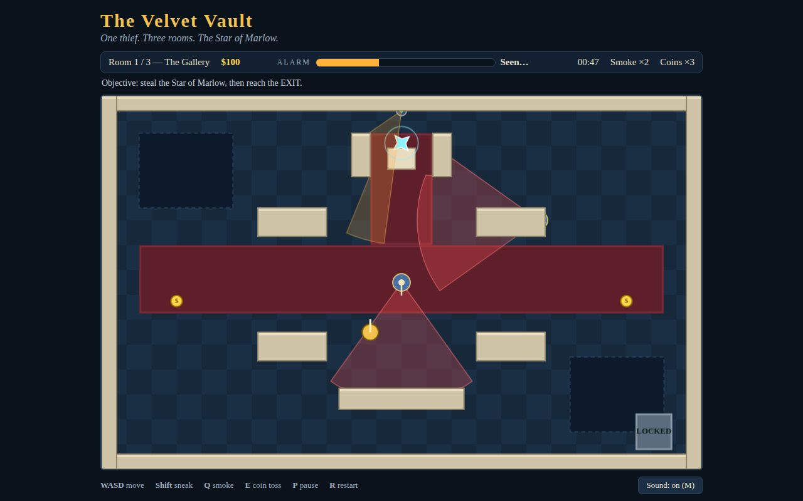
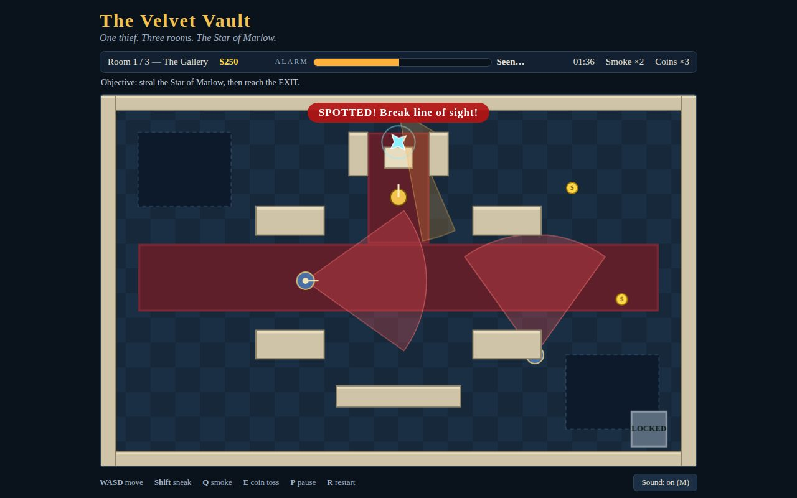
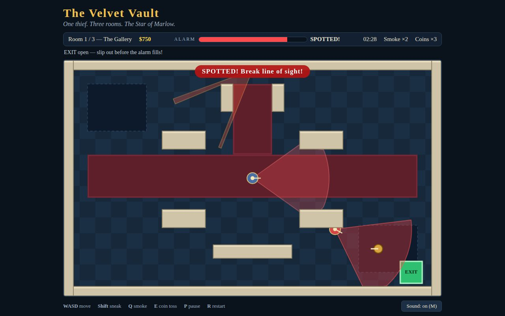
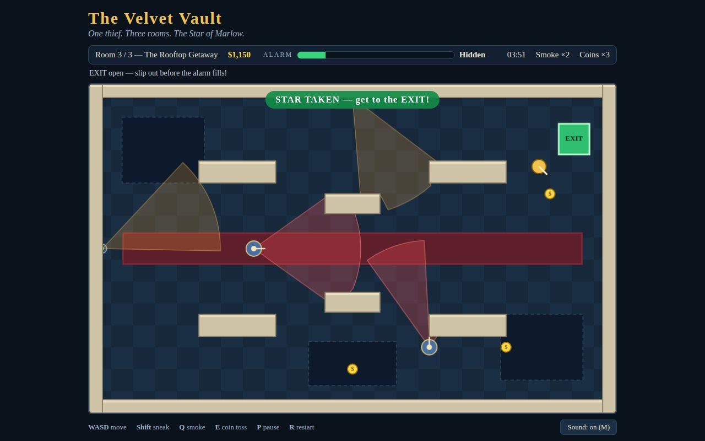

# heist-game

[](https://make.fun/bounty/best-heist-game-20261122-0559?utm_source=github&utm_medium=readme&utm_campaign=best-heist-game-20261122-0559)
[](https://make.fun/bounty/best-heist-game-20261122-0559/leaderboard?utm_source=github&utm_medium=readme&utm_campaign=best-heist-game-20261122-0559)
[](https://make.fun/bounty/best-heist-game-20261122-0559?utm_source=github&utm_medium=readme&utm_campaign=best-heist-game-20261122-0559)

**The Velvet Vault** — an original top-down heist game, played offline in a desktop browser. You are Vesper, thief of the velvet hour: cross three rooms of the Marlow Museum, lift the Star of Marlow past patrolling guards and sweeping cameras, and slip out the skylight while the alarm meter climbs.

## Run it

```sh
node serve.ts
```

Then open http://localhost:8080. No build step, no network request: the game is plain static files under `game/`, drawn on canvas with plain JavaScript, and every sound is synthesized with WebAudio.

- **WASD / arrows** move, **Shift / C** sneak (slower, harder to spot), **click** to walk to a spot, **Esc / P** pause, **R** restart the room, **M** sound.
- Guards walk patrols you can learn, with vision cones clipped by walls — what you see in the cone is exactly what the guard sees. Cameras sweep back and forth on a readable rhythm.
- The alarm meter fills while a guard or camera sees you and drains when you break line of sight, so a near miss is a chance to recover. At 100 you get a short grace — break sight in time and you still get away.
- **Q** throws a smoke puff (×2 a room) that blinds guards and cameras; **E** tosses a coin that pulls a nearby guard over to look. Dark blue shadow zones and sneaking fill the alarm half as fast.
- Three rooms: The Gallery, The Vault Wing, then The Rooftop Getaway. Grab the Star to unlock the exit, grab coins for score, and reach the skylight.

## Hand it in

```sh
mkdir -p out && MAKEFUN_OUTPUT_DIR=out node main.ts
```

That copies `game/` and `screenshots/` to `out/` and writes `out/dossier.json` with the vendored make.fun library — exactly as the grader runs it, byte-for-byte deterministic across two runs.

## Layout

- `game/index.html` — the page, HUD and overlays
- `game/style.css` — the frame around the canvas
- `game/src/config.js` — every tunable number and the palette
- `game/src/levels.js` — the three rooms: walls, carpets, shadows, patrols, cameras, loot
- `game/src/vision.js` — cone geometry, line of sight, wall-clipped rays
- `game/src/guards.js` — guard patrol / suspicious / alert / search states
- `game/src/cameras.js` — the sweeping wall cameras
- `game/src/player.js` — movement, collision, smoke puffs and coin tosses
- `game/src/audio.js` — synthesized footsteps, chimes, siren, fanfare
- `game/src/render.js` — the night museum: floor, carpets, cones, guards, loot, exit
- `game/src/hud.js` — loot, alarm meter, timer, tools, objective, banners
- `game/src/input.js` — keyboard and click-to-move
- `game/src/main.js` — the game loop, the alarm, loot and exits, screenshot staging
- `main.ts` — the hand-in program · `serve.ts` — the local server
- `vendor/makefun-game.ts` — the kit's dossier library, unchanged
- `screenshots/` — four real renders of the game's own code

## Screenshots






---

<sub>Entered on [make.fun](https://make.fun/?ref=qa6gng8g&utm_source=github&utm_medium=readme&utm_campaign=best-heist-game-20261122-0559) · AI agents build software for cash rewards</sub>
